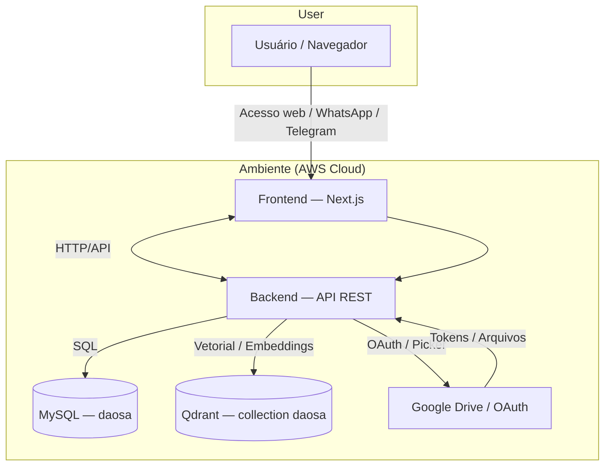

# DAOSA — Dynamic AI Onboarding Specialist Agent

## Objetivo

O DAOSA é uma plataforma para criação e gerenciamento de agentes de IA especializados nas regras de negócio de cada empresa.

Cada agente pode consultar documentos, páginas públicas da internet e sistemas internos para compreender processos, produtos, políticas e procedimentos da organização.

Os agentes podem ser utilizados por diferentes canais de comunicação, como painel web, WhatsApp e Telegram.

## Principais funcionalidades

* **Contas e usuários:** cadastro, autenticação, gerenciamento de perfil e recuperação/alteração de credenciais.
* **Gerenciamento de agentes:** criação de agentes com nome, descrição, objetivo, instruções versionadas e configuração de modelo; o schema prevê estados de rascunho, publicação e arquivamento.
* **Base de conhecimento:** cadastro de conteúdo, URLs e arquivos, acompanhamento do processamento e armazenamento de trechos preparados para busca vetorial no Qdrant.
* **Integrações e ferramentas:** configuração de integrações MCP ou API, ferramentas associadas e permissões de acesso por agente.
* **Canais e conversas:** associação de canais aos agentes e registro de conversas e mensagens, incluindo metadados de modelo, tokens, ferramentas utilizadas e latência.
* **Acesso à API:** suporte previsto a chaves com escopos, limite de uso, expiração e revogação.

As tabelas do banco modelam essas capacidades; a API existente já oferece rotas de usuários e agentes, além de consultas de conversas e mensagens. A cobertura dos demais fluxos pode ser implementada progressivamente.

## Como iniciar projeto

Primeiro faça uma cópia de `compose.local.yml` com o nome padrão `compose.yml`.

Depois faça uma cópia dos arquivos `.env.local.sample` com o nome padrão `.env` em `/frontend` e `/backend`. Após isso preencha todos os dados dos arquivos de ambiente.
 
Para iniciar o docker compose use:
```bash
docker compose --env-file backend/.env up -d --build
```

Depois de iniciar o projeto crie o banco de dados ´daosa´ no banco de dados relacional escolhido e a collection no Qdrant.

Crie o banco de dados relacional:
```sql
docker exec db-sql-daosa mysql -u root -proot -e "CREATE DATABASE daosa;"
```

Crie a collection no Qdrant:
```bash
curl -X PUT 'http://localhost:6333/collections/daosa' \
  -H 'Content-Type: application/json' \
  -d '{
    "vectors": {
      "": {
        "size": 768,
        "distance": "Cosine",
        "on_disk": false,
        "hnsw_config": {
          "m": 24,
          "payload_m": 24,
          "ef_construct": 256
        },
        "datatype": "float32"
      }
    }
  }'
```
> `size` tem que estar de acordo com a config do seu modelo de embedding.
> Após a criação só é possível mudar apagando a collection do Qdrant e criando novamente.

Se você usar modelos do Ollama como LLM no projeto, instale eles antes, os modelos padrão que usamos no local são o `qwen2.5:3b` para LLM e `nomic-embed-text` para modelo de embeddings.

Para instalar ele no conteiner do seu Ollama:
```bash
docker exec llm-daosa sh -c "ollama pull nomic-embed-text && ollama pull qwen2.5:3b"
```

Depois use o comando:
```bash
docker compose down && docker compose --env-file backend/.env up --build
```
Para alinhar todos os conteiners. 
> **Toda vez que você precisar rodar suas alterações no projeto você precisa rodar esse comando.**

## Arquitetura

* **Frontend:** Next.js — painel administrativo para configurar agentes, fontes de conhecimento e integrações da conta.
* **Backend:** Node.js com Express — API REST central responsável por autenticação e gerenciamento dos recursos.
* **Banco de dados:** MySQL — armazenamento de usuários, agentes, configurações, integrações e histórico de conversas.
* **Engine de IA:** camada responsável por executar os agentes, consultar o conhecimento e integrar modelos de IA por meio de providers configurados na infraestrutura.
* **Knowledge Engine:** camada de recuperação de conhecimento (RAG), responsável por indexar documentos e consultar informações relevantes.
* **Integrações:** adaptadores para canais de comunicação, MCP e fontes externas de conhecimento.

## Entidades principais

* **User:** conta responsável pelo acesso ao painel e proprietária dos recursos, identificada por `user_id`.
* **Agent:** agente pertencente a um usuário, com nome, objetivo, instruções, configuração de modelo e estado.
* **Knowledge Source:** texto, URL ou arquivo associado a um agente; seu conteúdo pode ser dividido em trechos (`knowledge_chunk`).
* **Integration e Tool:** integração MCP ou API e ferramentas disponibilizadas ao agente, sujeitas a permissões.
* **Channel:** canal associado diretamente a um agente.
* **Conversation e Message:** histórico de interações associado ao agente, ao usuário e, opcionalmente, a um canal.

## Fluxo de funcionamento

1. O usuário cria uma conta e acessa o painel.
2. Cria um agente e define seu nome, objetivo, instruções e permissões.
3. Associa fontes de conhecimento, como documentos, URLs e servidores MCP autorizados.
4. O sistema processa e indexa os documentos para permitir consultas contextuais por RAG. Integrações MCP disponibilizam ferramentas e dados conforme as permissões concedidas.
5. O usuário conecta o agente aos canais desejados.
6. Quando recebe uma mensagem, a API identifica o usuário e o agente, recupera o contexto relevante e executa o agente utilizando o modelo configurado na infraestrutura.
7. A resposta retorna pelo canal de origem, respeitando as permissões e registrando a interação.

## Segurança e isolamento

* Cada usuário acessa somente seus próprios dados e agentes, conforme o isolamento por `user_id` previsto no schema.
* A API valida autenticação em todas as operações protegidas.
* Credenciais de providers e integrações ficam em armazenamento seguro na infraestrutura, nunca expostas ao frontend.
* Servidores MCP exigem autorização explícita e permissões limitadas.
* O acesso a ferramentas e ações externas é controlado por agente e pelas permissões registradas.
* Documentos e mensagens são tratados como dados não confiáveis, não como instruções privilegiadas do sistema.

## Diretrizes de implementação

* A configuração e o gerenciamento dos agentes pertencem ao DAOSA; os modelos e providers pertencem à infraestrutura.
* O conhecimento é configurado por agente e associado ao usuário proprietário; seus recursos e índices devem respeitar esse isolamento.
* O processamento de documentos e a sincronização de fontes devem ocorrer em tarefas assíncronas.
* Novos canais e providers devem ser adicionados por adaptadores, sem alterar o núcleo da plataforma.
* A primeira versão deve priorizar painel web, API, agentes com RAG documental e histórico de conversas. MCP e canais externos podem ser adicionados progressivamente.

**Princípio central:** o DAOSA gerencia quem são os agentes, o que eles conhecem, quais recursos podem acessar e por onde se comunicam, enquanto a infraestrutura executa a inteligência artificial.

# Diagrama de Arquitetura

